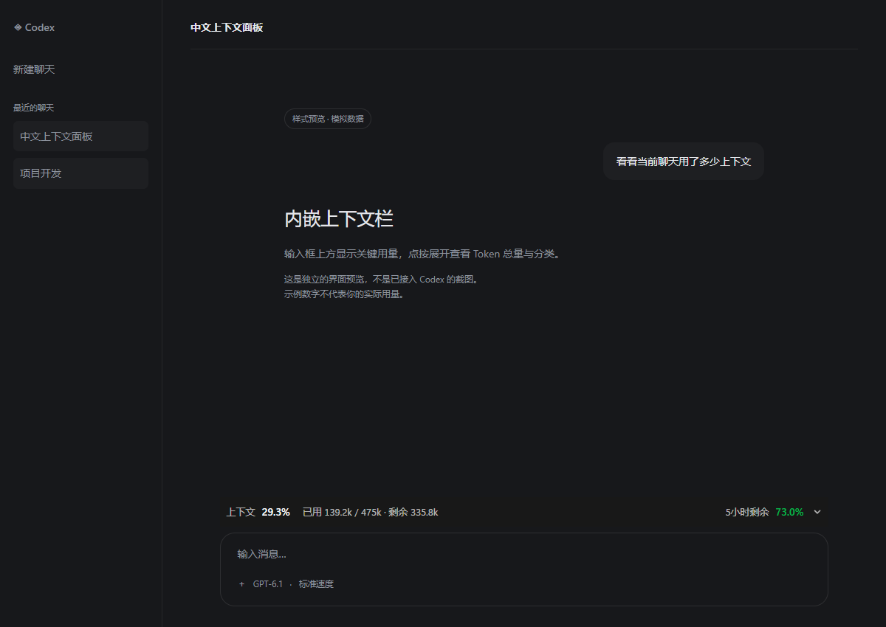
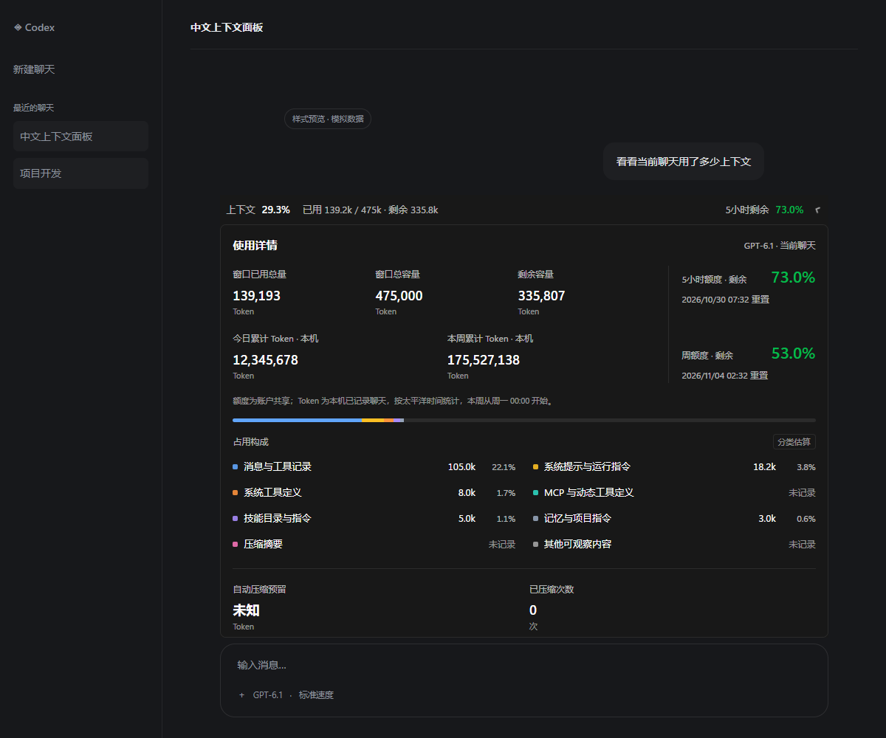

# Codex 中文状态栏

在 Windows 版 Codex 输入框上方显示上下文用量、已用 Token、5 小时剩余额度，以及本机今日／本周 Token。

**非官方社区小工具，与 OpenAI 无隶属关系。当前版本：1.5.1。**





以上截图使用模拟聊天和模拟用量，不包含真实账户或聊天数据。

## 功能

- 收起时显示上下文已用百分比、已用／总容量／剩余 Token、5 小时剩余额度。
- 点击展开，查看本机今日／本周 Token、5 小时／周额度和重置时间、上下文分类估算。
- 跟随当前聊天切换，适配深浅主题和窄窗口。
- 启动后静默预读最近 128 个聊天；已缓存聊天切换时立即恢复数据。
- 一轮对话期间保留上次快照，工具调用、压缩和额度轮询不会打断显示；结束或中止后更新。
- 可接管已有桌面／DeskBox 快捷方式，保留名称和位置，卸载时恢复原文件。
- 剩余额度按红、黄、绿显示；缺失数据和过期数据不会冒充剩余 100%。

## 安装

适用于 **Windows 10/11、Windows 版 Codex 桌面应用、Node.js 22+ 和可运行的 Codex CLI**。当前已在维护者本机的 Windows Store 版 Codex 验证；其他版本不保证兼容。macOS、Linux 和终端状态栏不在支持范围内。

1. 安装 [Node.js](https://nodejs.org/) 和 [Codex CLI](https://learn.chatgpt.com/docs/cli)，确认在 PowerShell 中能运行 `node --version`、`codex --version`，并已登录 Codex。
2. 在 [Releases](https://github.com/Canvai1337/codex-context-panel-zh/releases) 下载 `codex-context-panel-zh-v1.5.1-windows.zip`，解压到任意文件夹。
3. 在解压后的文件夹打开 PowerShell，运行：

   ```powershell
   powershell -NoProfile -ExecutionPolicy Bypass -File .\Install.ps1
   ```

4. 保存工作，正常退出 Codex，再双击桌面或开始菜单中的 **Codex 上下文面板**。

安装器会生成本机专用配置和快捷方式。安装后，日常使用从 **Codex 上下文面板** 快捷方式启动。首次启动需要以此入口开放仅绑定本机的面板连接端口；面板不会强制结束正在进行的聊天。

如需继续使用现有桌面或 DeskBox 中的入口，安装时传入实际快捷方式路径：

```powershell
.\Install.ps1 -ShortcutPath 'D:\你的快捷方式文件夹\ChatGPT.lnk'
```

该文件仍保留原名称与位置，改为同时启动 Codex 和面板；原始快捷方式备份在 `%LOCALAPPDATA%\CodexContextPanel`，卸载自动恢复。后续安装会自动更新已接管的入口。此功能针对 `.lnk` 文件；Windows 自带的应用列表和原生任务栏固定入口不会自动改写。

安装目录：`%LOCALAPPDATA%\Programs\CodexContextPanel\1.5.1`。不需要管理员权限。安装和运行无需 `npm install`；npm 开发依赖仅用于下文的测试和预览。

## 数据说明与隐私

- **当前上下文 Token**：来自本机 Codex 日志最近一次请求的用量与模型窗口容量，并非整个聊天累计消耗，也不等于距离自动压缩的精确余量。
- **上下文分类**：按可观察文本的 UTF-8 字节权重估算，不能精确归因图像、加密推理或未记录的服务端内容。
- **5 小时／周额度**：通过已有 Codex CLI 的只读 `app-server` 连接获取账户共享额度。协议参考 [OpenAI App Server 文档](https://learn.chatgpt.com/docs/app-server)。
- **今日／本周 Token**：汇总本机 `sessions` 和 `archived_sessions` 的已记录请求，不是跨设备账单。当前采用 `America/Los_Angeles` 时区，周一开始一周；额度重置区间与自然周不同。
- 面板会读取本机聊天日志以计算上下文分类，不导出聊天正文，也不创建提示词副本；登录文件仅检查元数据，不解析凭据内容。不向第三方服务上传聊天或用量。
- 接入方式是在 Codex 渲染器中通过本机 CDP 临时加入状态栏，依赖桌面应用的内部页面结构。Codex 更新可能使面板失效。不修改 WindowsApps 或 `app.asar`；只在指定 `-ShortcutPath` 时接管选定的快捷方式及后续升级。

详细口径、刷新频率和维护说明见 [使用说明](使用说明.md)。

## 卸载

在 PowerShell 中运行，然后正常重启 Codex：

```powershell
& "$env:LOCALAPPDATA\Programs\CodexContextPanel\1.5.1\Uninstall.ps1"
```

如需一并删除面板诊断文件，在命令末尾加 `-RemoveSettings`。卸载只停止本面板及其只读 app-server，不停止 Codex 应用或其他聊天。

## 常见问题

**提示没有开放面板接入端口**：保存工作并正常退出 Codex，再通过“Codex 上下文面板”或已接管的原快捷方式启动。

**额度显示“—”或“待刷新”**：检查 Codex CLI 登录和网络状态，等待下一次额度查询。面板不会自行猜测额度。

**面板没有出现**：确认正在查看本机聊天、已通过面板快捷方式启动；检查 `%LOCALAPPDATA%\CodexContextPanel` 的错误日志。反馈问题时请先删除日志中的个人路径、聊天内容和账户信息。

## 开发与验证

需要 Node.js 22+ 和 Google Chrome（现有浏览器测试使用 Playwright 的 `chrome` channel）。

```powershell
npm ci
npm test
npm run preview
```

预览输出到仓库内的 `outputs/中文上下文面板-交互预览.html`，双击即可查看。测试覆盖日志增量读取、重复用量去重、额度状态、深浅主题、窄窗口及本机 CDP 桥接。桥接测试使用临时模拟日志与独立测试浏览器，不连接实际 Codex 聊天。

## 文件怎么放

| 文件 | 用途 |
| --- | --- |
| `widget.js` | 状态栏界面 |
| `data.mjs`、`usage.mjs`、`account.mjs` | 上下文、本机 Token 和账户额度 |
| `cdp.mjs`、`daemon.mjs` | 本机连接与后台刷新 |
| `Install.ps1`、`Start.ps1`、`Launch.vbs`、`Uninstall.ps1` | Windows 安装、启动、卸载 |
| `Shortcuts.ps1` | 现有快捷方式接管、备份和恢复 |
| `tests/`、`fixture.mjs`、`build-preview.mjs` | 自动检查与模拟预览 |
| `assets/` | README 使用的模拟截图 |

源码和说明放在仓库，用户下载的安装 ZIP 放在 Releases。运行配置、日志、聊天记录、`node_modules/` 和预览输出由 `.gitignore` 排除。

## 许可证与来源

本项目采用 [MIT License](LICENSE)。参考项目和第三方说明见 [THIRD-PARTY-NOTICES.txt](THIRD-PARTY-NOTICES.txt)。
